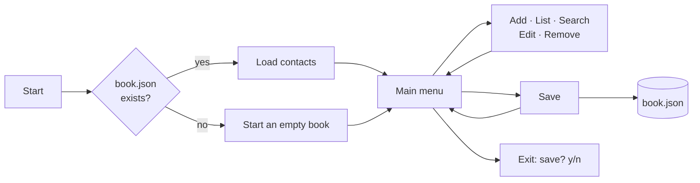

<div align="center">

# 📇 Contact Book

**An interactive command-line contact manager in Python, with search, editing and JSON persistence**


[](https://colab.research.google.com/github/Laurentius96/Contact_Book/blob/main/main.ipynb)

<p>
  <a href="#-overview">Overview</a> •
  <a href="#-features">Features</a> •
  <a href="#-how-it-works">How It Works</a> •
  <a href="#-sample-session">Sample Session</a> •
  <a href="#-how-to-run">How to Run</a> •
  <a href="#-license">License</a>
</p>

</div>

---

## 🔍 Overview

**Contact Book** is a menu-driven terminal app to add, list, search, edit and remove contacts, saving them to a JSON file between sessions. It was built as a Python case in the **DNC School Data Scientist program** to practice the language fundamentals in a complete, working program.

| Concept | Where it shows up |
|---|---|
| 🧱 Data structures | Contacts are dictionaries stored in a list |
| 🧩 Functions | One function per operation, plus layout helpers |
| 🔁 Control flow | Main menu loop, numbered selection, y/n confirmations |
| 🛡️ Input handling | Empty-name check, `ValueError` handling for numeric choices |
| 💾 File I/O | Load and save with the `json` module |
| 🖥️ Terminal UI | Box-drawn headers and contact cards built with f-string alignment |

<details>
<summary><b>What this version adds to the class solution</b></summary>
<br>

The course's reference solution adds, lists, edits and removes contacts by exact name. This version also:

- searches by **full or partial name**, case-insensitive;
- edits and removes contacts by **number**, with a **0 to cancel** option;
- keeps the current value when an edit field is left **blank**;
- asks for **confirmation** before removing and offers to **save on exit**;
- rejects contacts with an **empty name**;
- formats the whole interface with **box-drawn headers and cards**.

</details>

## ✨ Features

| Option | Action | Details |
|:---:|---|---|
| 1 | ➕ Add contact | Name (required), phone and email |
| 2 | 📋 List contacts | Shows the total and every contact as a card |
| 3 | 🔎 Search contact | Full or partial name, case-insensitive |
| 4 | ✏️ Edit contact | Pick by number; blank fields keep their current value |
| 5 | 🗑️ Remove contact | Pick by number and confirm with `y` |
| 6 | 💾 Save | Writes the contact list to `book.json` |
| 7 | 🚪 Exit | Asks whether to save before closing |

## 🧭 How It Works



Each contact is a dictionary, and the book is saved as a JSON list ([`book.json`](book.json) holds two sample contacts):

```json
[
  {
    "name": "Test01",
    "phone": "9999999",
    "email": "test01@example.com"
  }
]
```

## 🎬 Sample Session

<details open>
<summary><b>Adding and searching a contact</b> (real output, trimmed; typed values shown after each prompt)</summary>
<br>

```text
┌──────────────────────────────────────────────────┐
│                  ■ CONTACT BOOK                  │
└──────────────────────────────────────────────────┘

• Please fill in the new contact details:

  Name: Ada Lovelace
  Phone: 555-0100
  Email: ada@example.com

✓ Contact added successfully!

• Enter your choice (1-7): 3

• Enter name or part of name: ada

✓ Found 1 contact(s):

• Result #1

┌──────────────────────────────────────────────────┐
│ Name: Ada Lovelace                               │
│ Phone: 555-0100                                  │
│ Email: ada@example.com                           │
└──────────────────────────────────────────────────┘
```

</details>

<details>
<summary><b>Editing a contact</b> (real output, trimmed)</summary>
<br>

```text
• Available contacts:
  1. Test01
  2. Test02
  3. Ada Lovelace

• Enter contact number (or 0 to cancel): 3

• Enter new details (leave blank to keep current value):
  Name [Ada Lovelace]: 
  Phone [555-0100]: 555-0199
  Email [ada@example.com]: 

✓ Contact updated successfully!
```

</details>

## 🚀 How to Run

**Option 1: Google Colab (no installation).** Click the **Open in Colab** badge above and run the cell.

**Option 2: Jupyter.**

```bash
git clone https://github.com/Laurentius96/Contact_Book.git
cd Contact_Book
pip install notebook
jupyter notebook main.ipynb
```

**Option 3: terminal (best experience, since screen clearing only works in a terminal).**

```bash
jupyter nbconvert --to script main.ipynb
python main.py
```

Only the Python standard library is used (`json`, `os`, `time`); Python 3.8 or newer is recommended.

## 🚧 Limitations

- **Saving is manual:** use option 6, or answer `y` when exiting; otherwise changes are lost.
- Phone and email are free text, with no format validation, and duplicate names are allowed.
- In Jupyter and Colab, the screen-clearing calls have no effect, so the output keeps growing.

## 📁 Project Structure

```
📁 Contact_Book/
├── 📓 main.ipynb     # The whole application in one code cell
├── 📄 book.json      # Saved contacts (two sample entries)
├── 📄 LICENSE.md     # CC BY-NC-ND 4.0
└── 📄 README.md
```

## 🤝 Contributing

Contributions, ideas and feedback are welcome!

- 🐛 **Found a bug or something unclear?** [Open an issue](https://github.com/Laurentius96/Contact_Book/issues/new) describing what happened and how to reproduce it.
- 💡 **Have an idea or a question?** [Open an issue](https://github.com/Laurentius96/Contact_Book/issues/new) and tell me about it.
- 🔧 **Want to propose a fix?** Fork the repository, create a branch (`git checkout -b fix/short-description`), commit your changes and open a pull request explaining what changed and why.

By contributing, you agree that your contribution is shared under the same license as this project.

## 📜 License

This project is licensed under the [Creative Commons Attribution-NonCommercial-NoDerivatives 4.0 International License (CC BY-NC-ND 4.0)](LICENSE.md). The case statement belongs to DNC School.

**What this means:**
- ✅ You may **share** this work with **attribution**
- ❌ You may **not** use it for **commercial purposes**
- ❌ You may **not** distribute **modified versions**

---

<div align="center">

**Lorenzo C. Bianchi** · [GitHub](https://github.com/Laurentius96) · [LinkedIn](https://www.linkedin.com/in/cb-lorenzo/)

</div>
